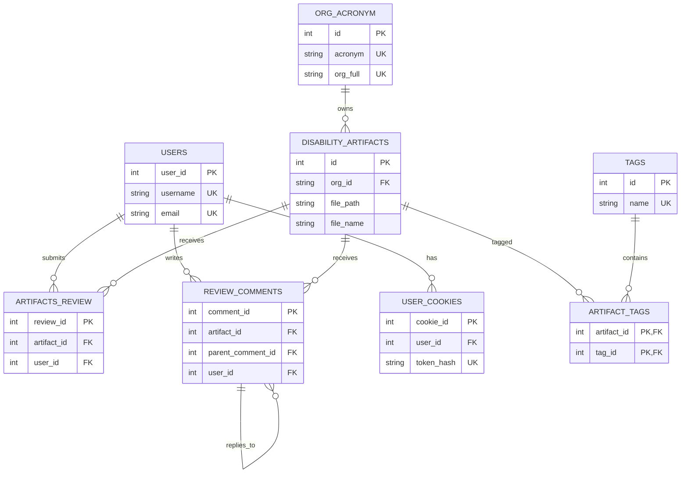

# Disability Data Archive

This is the repository for the disability data archive run by the American Association of People with Disabilities.
All webpages are run server-side. 


## Development

For development, please follow the instructions below.

### TL;DR

```
copy .env.example .env
npm i
docker compose up -d
npm run dev
```

### Step 1: Set local environment variables

Create a `.env` file by copying `.env.example`.
Update the variables in `.env` according to your preferences and development environment.

Environment variables:

| Variable | Description |
| --- | --- |
| `PORT` | Port used by the application server. Defaults to `3000`. |
| `UPLOAD_DIRECTORY` | Directory where uploaded dataset and image files are stored. Defaults to `uploads`; the directory is created automatically if it does not exist. |
| `DB_USERNAME` | PostgreSQL username used by Docker Compose and the application database connection. |
| `DB_PASSWORD` | Password for `DB_USERNAME`, used by Docker Compose and the application database connection. |
| `DATABASE_URL` | PostgreSQL connection string used by the application and migration scripts. Use `db` as the hostname inside Docker Compose and `localhost` when running commands directly on the host. |

```
copy .env.example .env
```

### Step 2: Install dependencies using NPM

1. Make sure NPM is installed or install it from [here](https://www.npmjs.com/). 
2. Navigate to the directory containing this project and install the dependencies:

    ```
    npm i
    ``` 

### Step 3: Install and initialize Docker

In addition to the NPM dependencies, we will be using:
- PostgresSQL, our database.
- NodeJS.

It would be time-consuming to install and configure all of these on your computer. So we use a service called Docker to containerize all of the depedencies we need. This means that you will not need to install Postgres to your local machine, but only run Docker. Importantly, if you use **Windows**, you will need to download the Windows Subsystem for Linux (WSL) from the Microsoft Store before you use Docker.

1. **OPTIONAL, ONLY IF YOU USE WINDOWS**: Install the Windows Subsystem for Linux on the Microsoft Store.
2. Make sure [Docker](https://docs.docker.com/get-docker/) is installed and setup
3. Navigate to the directory containing this project and run:

    ```
    docker compose build
    ```

### Step 4: Start development

There are two ways to run the project-- through Docker (step 1) or locally using Postgres on your machine (step 2): 

#### DOCKER
1. Start up the required development infrastructure:
    ```
    docker compose up -d
    ```
    If you run this command, you should see the status of each container. You can then run ```docker ps``` to see the running containers.


    > Note: You can run `docker container ls` to see a list of your containers. Learn more about Docker commands [here](https://docs.docker.com/engine/reference/commandline/container_ls/).

2. To open a PostgreSQL shell in the Docker database:
    ```
    docker exec -it backend psql -U archive -d disability_archive
    ```

#### LOCAL

While `npm run dev` is running, edits under `src/` restart Hono and automatically reload any open browser page. This is a benefit to running the frontend locally.

1. Start the frontend:
    ```
    npm run dev
    ```

2. To start the backend, open PostgresSQL and run:
    ```
    npm run db:migrate
    npm run dev
    ```

3. To insert the dummy data while running locally:
    ```
    npm run data
    ```


Importantly, it is optional to run either the frontend and/or backend locally -- for dev work, I often run the frontend locally, and have docker run the backend.

### Step 5: Stop development

1. Stop development infrastruture by running:

    ```
    docker compose stop
    ```


### Other tips

I use pgAdmin also running on a docker container to interface with my SQL database. When you want pgAdmin to connect to a docker container, use this URL for the hostname:

- host.docker.internal


### Need More Help?

Please add an issue to this repo if you have any questions or bug reports.


## Dataset Schema

The PostgreSQL database uses the following tables. The initial schema is defined in
[`migrations/001_init.sql`](migrations/001_init.sql); later migrations add review-comment
and persistent-login fields.

| Table | Purpose | Important relationships |
| --- | --- | --- |
| `users` | User accounts, reputation, and account status | Referenced by `artifacts_review`, `review_comments`, and `user_cookies` |
| `org_acronym` | Organizations and their acronyms | `disability_artifacts.org_id` references `org_acronym.acronym` |
| `disability_artifacts` | Dataset and other submitted artifact metadata | Referenced by reviews, comments, and `artifact_tags` |
| `artifacts_review` | Approval or denial reviews for artifacts | References `disability_artifacts` and `users` |
| `review_comments` | Comments and threaded replies on artifacts | References `disability_artifacts`, `users`, and itself through `parent_comment_id` |
| `tags` | Reusable searchable tags | Connected to artifacts through `artifact_tags` |
| `artifact_tags` | Many-to-many artifact/tag join table | References `disability_artifacts` and `tags` |
| `user_cookies` | Hashed persistent-login tokens | References `users`; tokens are unique and have an expiration time |

### Main table columns

| Table | Columns |
| --- | --- |
| `users` | `user_id`, `username`, `email`, `password_hash`, `reputation`, `flag_amount`, `is_locked`, `created_at` |
| `org_acronym` | `id`, `acronym`, `org_full` |
| `disability_artifacts` | `id`, `artifact_type`, `file_path`, `file_name`, `org_id`, `reviewed`, `dataset_date`, `added_at`, `created_at`, `updated_at`, `dataset_description`, `dataset_kind`, `dataset_status` |
| `artifacts_review` | `review_id`, `artifact_id`, `user_id`, `review_status`, `review_ratings` |
| `review_comments` | `comment_id`, `artifact_id`, `parent_comment_id`, `user_id`, `comment_text`, `comment_date`, `edited_at` |
| `tags` | `id`, `name` |
| `artifact_tags` | `artifact_id`, `tag_id` |
| `user_cookies` | `cookie_id`, `user_id`, `token_hash`, `created_at`, `expires_at` |

### Relational graph


